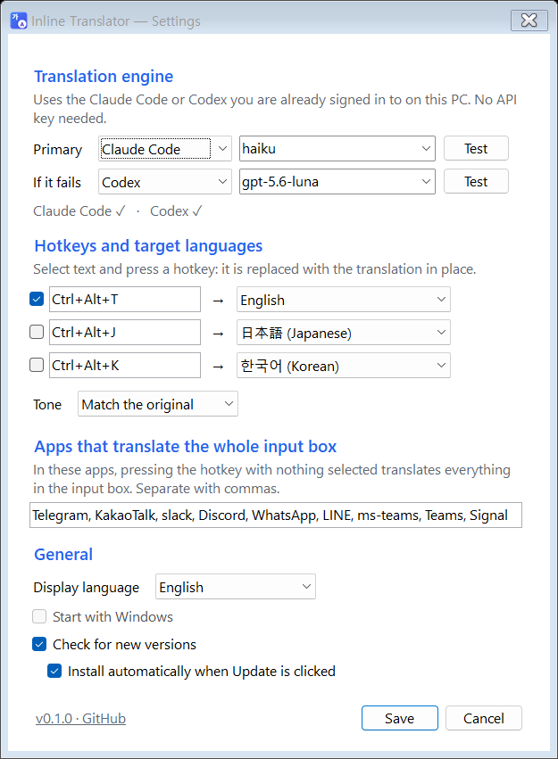

<p align="center"></p>

<h1 align="center">Inline Translator</h1>

<p align="center"><a href="README.md">한국어</a> · <b>English</b> · <a href="README.zh-CN.md">简体中文</a> · <a href="README.ja.md">日本語</a></p>

Tired of opening ChatGPT or Claude, pasting, copying and switching back just to translate one line?

Now it is **one hotkey, right where you are typing**. In a few seconds your text turns into the translation in place.

<p align="center"></p>
<p align="center"><sub>A reenactment built from a real Claude Haiku translation.</sub></p>

## How it works

1. Type as usual — Telegram, Slack, email, documents, anywhere.
2. Select what you want translated and press **`Ctrl+Alt+T`**. In chat apps you can skip selecting: the whole input box is translated.
3. Two to four seconds later the translation replaces your text. Don't like it? `Ctrl+Z`.

## Features

- **No API key** — uses the Claude Code or Codex subscription you already have.
- **Pick the model** — Haiku, Sonnet, Opus, GPT models, or any model name you type.
- **Fallback engine** — if the main engine fails, the backup takes over automatically.
- **19 languages** — English, Korean, Japanese, Chinese (Simplified and Traditional), Spanish, French, German, Portuguese, Italian, Russian, Vietnamese, Thai, Indonesian, Arabic, Hindi, Turkish, Dutch and Polish. The source language is detected automatically.
- **Three hotkeys** — for example `Ctrl+Alt+T` for English and `Ctrl+Alt+J` for Japanese.
- **Tone** — match the original, casual, or polite.
- **Safe by default** — if you switch windows while it is translating, the result goes to the clipboard instead of being pasted. Your previous clipboard is restored.
- **Nothing recorded** — translated text is never written to disk or to Windows clipboard history (`Win+V`).
- **One-click update** — when a new version is out, an `Update` button appears in the tray menu and Settings. Click it to download, replace and restart.
- **Interface languages** — 한국어, English, 简体中文, 日本語.

## Getting started

1. **Set up an engine** — at least one of these, installed and signed in:
   - [Claude Code](https://docs.anthropic.com/en/docs/claude-code): install, run `claude` in a terminal and sign in
   - [Codex CLI](https://github.com/openai/codex): install, then `codex login`
2. **[Download the latest release](https://github.com/HSoo-Kim/inline-translator/releases/latest)**, unzip `inline-translator-win-x64.zip` and run `InlineTranslator.exe`.
3. Settings open on first launch. Press `Test` next to an engine to check it works, then `Save`.

From then on it runs quietly in the notification area. Click the icon for Settings; right-click to pause or exit.

Built for Windows 11 x64. The executable includes .NET, so nothing else to install. It is not code-signed yet, so Windows may warn on first launch.

## Settings

<p align="center"></p>

| Section | What it does |
|---|---|
| Translation engine | Main engine and the one to use if it fails. Pick a model from the list or type its name. |
| Hotkeys and target languages | Click a hotkey box and press the combination you want. |
| Apps that translate the whole input box | In these apps the hotkey works without selecting. Default: Telegram, KakaoTalk, Slack, Discord, WhatsApp, LINE, Teams, Signal |
| General | Interface language, start with Windows, update checks |

## Data and privacy

- Text is sent **only to the engine you chose** (Claude Code or Codex). The app itself sends it nowhere else.
- Engines run with session saving off (`--no-session-persistence`, `--ephemeral`), tools disabled, inside an empty temporary folder that is deleted right after.
- The error log (`%LOCALAPPDATA%\InlineTranslator\error.log`) holds error messages only, never your text.
- Update checks read only the latest release from GitHub (`api.github.com`). Updates install only if the SHA-256 published by GitHub matches. You can turn this off.
- Settings file: `%LOCALAPPDATA%\InlineTranslator\settings.json`
- Translations count toward your subscription usage.

## Good to know

- Tested with Claude Code 2.1.300 and Codex CLI 0.153.2. Much older versions may lack some options.
- Some apps (code editors, for example) copy the whole line when you press `Ctrl+C` with nothing selected. Select the text first there.
- Windows does not allow pasting into windows running as administrator.
- If another program already uses your hotkey, you will be told; choose a different one in Settings.

## Building from source

Requires Windows 11 x64 and the .NET 10 SDK.

```powershell
.\build.ps1                 # build + unit tests
.\build.ps1 -Screenshots    # re-render settings screenshots on a private desktop
.\build.ps1 -Publish        # self-contained executable and ZIP
```

The demo GIF is rendered frame by frame from `docs/demo/demo.html`.

```
src/InlineTranslator/   app (tray, hotkeys, engines, settings, updates)
tests/                  settings, hotkey, engine and update regression tests
tools/Preview/          settings rendering and real engine translation checks
tools/PrivateDesktopQa/ private-desktop runner that never touches your screen
```

No NuGet dependencies: .NET Windows Forms and Win32 APIs only.

## License

[MIT](LICENSE). Free for personal and commercial use, modification and distribution; keep the copyright and license notice when you redistribute.
