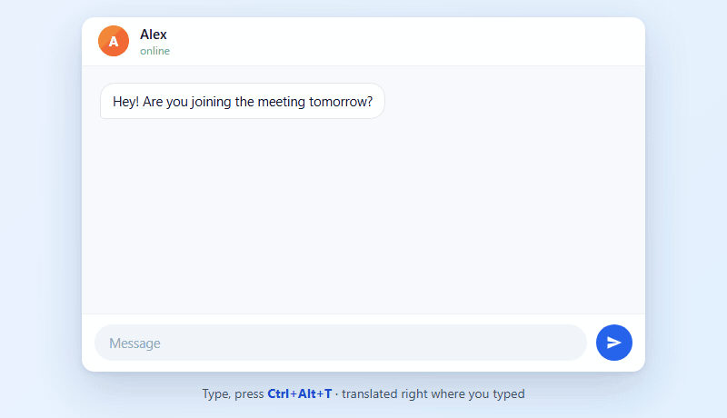
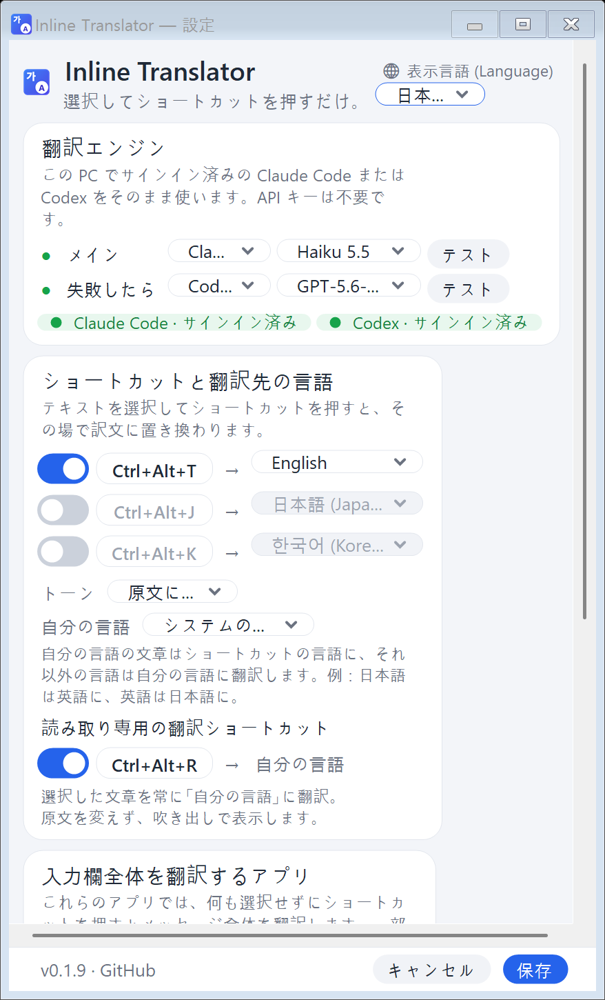

<p align="center"></p>

<h1 align="center">Inline Translator</h1>

<p align="center"><a href="README.md">한국어</a> · <a href="README.en.md">English</a> · <a href="README.zh-CN.md">简体中文</a> · <b>日本語</b></p>

一文を翻訳するために ChatGPT や Claude を開いて、貼り付けて、コピーして戻ってくる。面倒ですよね？

これからは**入力している場所でショートカットを一回**押すだけ。数秒でその場の文章が訳文に置き換わります。

> **原文の言語を選ぶ必要はありません。** 韓国語でも日本語でも、複数の言語が混ざっていても自動で判定し、設定した言語に翻訳します。選ぶのは「何語にするか」だけです。

<p align="center"></p>
<p align="center"><sub>実際の Claude Haiku の翻訳結果で再現したデモです。</sub></p>

## 使い方

| こうすると | こう翻訳されます |
|---|---|
| 💬 チャットの入力欄で**そのまま `Ctrl+Alt+T`** | 入力欄の**文章全体**を翻訳 |
| 🖱️ **ドラッグで選択してから `Ctrl+Alt+T`** | **選択した部分だけ**を翻訳（チャット、メール、文書などどこでも） |
| **選択してから `Ctrl+Alt+R`** | **自分の言語**に翻訳し、原文を変えず吹き出しで表示 |
| **翻訳中に `Esc`** | 実行中の翻訳をキャンセル |

- 2～4 秒でその場が訳文に変わります。気に入らなければ `Ctrl+Z`。
- 選択なしで入力欄全体を翻訳するアプリ：Telegram、KakaoTalk、Slack、Discord、WhatsApp、LINE、Teams、Signal。設定で追加・削除できます。
- それ以外のアプリ（Word、ブラウザーなど）では、文書全体が置き換わらないよう選択部分だけを翻訳します。

## 機能

- **API キー不要** —— すでに使っている Claude Code または Codex のサブスクリプションをそのまま使います。
- **モデルを選べる** —— Haiku 5.5、Sonnet 5.5、Opus 5.5、Fable 5、GPT 系、モデル名の直接入力も可。
- **予備エンジン** —— メインが失敗したら自動で切り替えます。
- **サインイン状態** —— サインイン済みのエンジンは緑色で表示。サインインが必要ならボタン一つでサインイン画面が開き、翻訳中に期限切れになっても通知をクリックしてすぐ再サインインできます。
- **アプリは一覧から選ぶ** —— 入力欄全体を翻訳するチャットアプリは、PC にインストール済みのアプリから選んで追加。誤って文書エディターを加えても文書全体は置き換わりません。
- **19 言語** —— 英語、韓国語、日本語、中国語（簡体・繁体）、スペイン語、フランス語、ドイツ語、ポルトガル語、イタリア語、ロシア語、ベトナム語、タイ語、インドネシア語、アラビア語、ヒンディー語、トルコ語、オランダ語、ポーランド語。原文の言語は自動判定します。
- **ショートカット 3 つ** —— たとえば `Ctrl+Alt+T` は英語、`Ctrl+Alt+J` は日本語。
- **双方向** —— 自分の言語の文章はショートカットの言語に、それ以外の言語は自分の言語に。ショートカット一つで日本語は英語に、英語や韓国語などは日本語になります。「自分の言語」は設定で変更できます。
- **トーン** —— 原文に合わせる、カジュアル、丁寧。
- **読み取り専用の文章は吹き出しで** —— 受信メッセージ、Web ページ、PDF など編集できない文章を選択してショートカットを押すと、訳文を小さな吹き出しで表示。何かキーを押すかクリックするとすぐ消えます。白背景・黒文字と黒背景・白文字から選べ、位置はマウスに追従（既定）か、選択したテキストのすぐ上・下に固定かを選べます。
- **入力を保護** —— 翻訳中に入力したりクリックでカーソルを動かした場合、原文を置き換えず訳文を吹き出しで表示します。貼り付け直前にも選択内容を確認。入力欄全体の翻訳でも、再び全選択して新しく書いた文章を上書きしません。
- **読むためのショートカット** —— `Ctrl+Alt+R` は選択した文章を常に「自分の言語」に翻訳し、吹き出しだけを表示。編集可否の推測や貼り付けを行いません。設定で変更・無効化できます。
- **Esc でキャンセル** —— 翻訳中に `Esc` を押すと実行中のエンジンを停止。予備エンジンは起動せず、エラーも記録しません。翻訳後は元のアプリで Esc が通常どおり使えます。
- **記録しない** —— 訳文はファイルにも Windows のクリップボード履歴（`Win+V`）にも残りません。
- **ワンクリック更新** —— 新しいバージョンが出ると、通知領域のメニューと設定に「更新」ボタンが表示され、押すとダウンロード・置き換え・再起動します。
- **表示言語** —— 한국어、English、简体中文、日本語。設定画面の一番上か通知領域のメニューですぐ切り替えられます。

## はじめに

1. **翻訳エンジンを用意** —— 次のどちらかをインストールしてサインインしておきます。
   - [Claude Code](https://docs.anthropic.com/en/docs/claude-code)：インストール後、ターミナルで `claude` を実行してサインイン
   - [Codex CLI](https://github.com/openai/codex)：インストール後 `codex login`
2. **[最新版をダウンロード](https://github.com/HSoo-Kim/inline-translator/releases/latest)** して `inline-translator-win-x64.zip` を展開し、`InlineTranslator.exe` を実行。
3. 初回は設定画面が開きます。エンジン横の「テスト」で動作を確認して「保存」。

その後は通知領域で静かに動きます。アイコンをクリックで設定、右クリックで一時停止・終了。

Windows 11 x64 用です。実行ファイルに .NET が含まれているので追加のインストールは不要です。コード署名がないため、初回起動時に Windows が警告を出すことがあります。

## 設定

設定ウィンドウは端をドラッグしてサイズ変更でき、最大化もできます。小さい画面やリモート接続では内容をスクロールし、保存・キャンセルは下部に固定されます。解像度や倍率が変わると、現在の作業領域内にウィンドウを収めます。

<p align="center"></p>

| 項目 | 内容 |
|---|---|
| 翻訳エンジン | メインと失敗時に使うエンジン。モデルは一覧から選ぶか直接入力します。 |
| ショートカットと翻訳先の言語 | ショートカット欄をクリックして、使いたいキーの組み合わせを押します。 |
| 読み取り専用翻訳のショートカット | 既定は `Ctrl+Alt+R`。選択した文章を自分の言語に翻訳して吹き出しで表示。 |
| 入力欄全体を翻訳するアプリ | これらのアプリでは選択しなくても入力欄全体を翻訳します。既定：Telegram、KakaoTalk、Slack、Discord、WhatsApp、LINE、Teams、Signal |
| 表示言語 | アプリ自体の言語。選ぶとすぐに切り替わります。 |
| 全般 | Windows 起動時に実行、更新の確認 |

## データとプライバシー

- テキストは**選んだエンジン（Claude Code または Codex）にだけ**送られます。アプリ自体が他へ送ることはありません。
- エンジンは会話を保存しない設定（`--no-session-persistence`、`--ephemeral`）で、ツールを無効にし、使用後すぐ削除する空の一時フォルダーで実行されます。
- エラーログ（`%LOCALAPPDATA%\InlineTranslator\error.log`）にはエラー内容だけが残り、翻訳した文章は残りません。
- 更新確認は GitHub（`api.github.com`）から最新リリース情報だけを読みます。GitHub が公開する SHA-256 と一致した場合だけインストールします。設定でオフにできます。
- 設定ファイル：`%LOCALAPPDATA%\InlineTranslator\settings.json`
- 翻訳はご利用中のサブスクリプションの使用量に含まれます。

## 注意点

- **PDF**：ドラッグしたときに編集ウィンドウが出たら、`Esc` で閉じてからショートカットを押すと翻訳されます。
- **読むための翻訳**：選択・コピーの動作はアプリごとに異なり、スムーズに動かない場合があります。PDF や Web 本文には貼り付けを行わない `Ctrl+Alt+R` をおすすめします。文字をコピーできない画像だけの PDF には対応していません。
- Claude Code 2.1.300、Codex CLI 0.153.2 で確認しています。古すぎるバージョンでは一部のオプションがなく失敗することがあります。
- コードエディターなど一部のアプリは、何も選択せずに `Ctrl+C` を押すと行全体をコピーします。先に選択してください。
- 管理者として実行中のウィンドウには、Windows の仕様上貼り付けできません。
- ショートカットが他のプログラムと重なっている場合はお知らせします。設定で別の組み合わせを選んでください。

## ソースからビルド

Windows 11 x64 と .NET 10 SDK が必要です。

```powershell
.\build.ps1                 # ビルド + 単体テスト
.\build.ps1 -Screenshots    # 設定画面のスクリーンショットを非公開デスクトップで再生成
.\build.ps1 -Publish        # ランタイム同梱の実行ファイルと ZIP を生成
```

デモ GIF は `docs/demo/demo.html` をフレームごとに描画して作っています。NuGet パッケージへの依存はなく、.NET Windows Forms と Win32 API だけを使います。

## ライセンス

[MIT](LICENSE)。個人・企業を問わず無料で使用・改変・配布できます。再配布の際は著作権表示とライセンス表示を含めてください。
