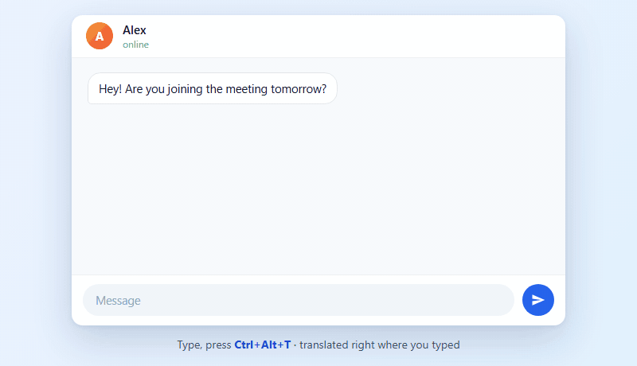
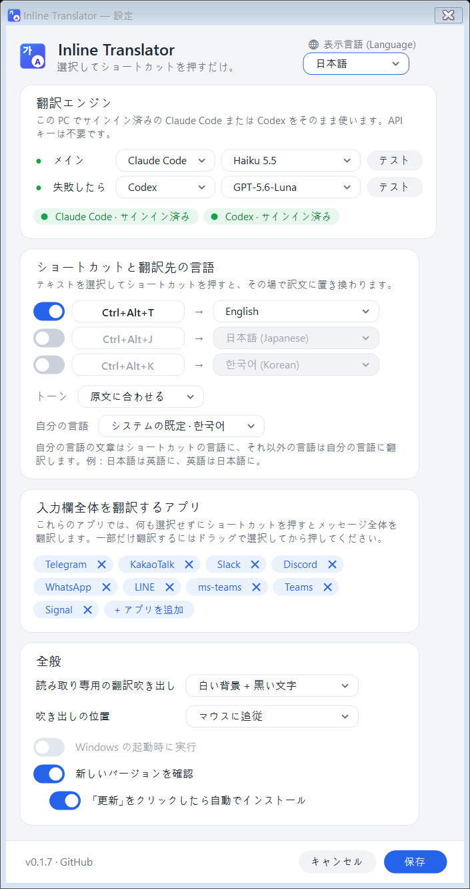

<p align="center"></p>

<h1 align="center">Inline Translator</h1>

<p align="center"><b>入力中の場所で翻訳。読むときは吹き出しで。</b></p>

<p align="center">
  <a href="https://github.com/HSoo-Kim/inline-translator/releases/latest/download/inline-translator-win-x64.zip"></a>
  <a href="https://github.com/HSoo-Kim/inline-translator/releases/download/mac-v0.2.1/inline-translator-mac.dmg"></a>
  <a href="https://github.com/HSoo-Kim/inline-translator/releases/latest"></a>
  <a href="https://github.com/HSoo-Kim/inline-translator/releases"></a>
  <a href="https://github.com/HSoo-Kim/inline-translator/stargazers"></a>
  <a href="LICENSE"></a>
</p>

<p align="center"><a href="README.md">한국어</a> · <a href="README.en.md">English</a> · <a href="README.zh-CN.md">简体中文</a> · <b>日本語</b></p>
<p align="center"><sub>Windows 11 x64 · macOS 13 以降（Apple Silicon・Intel）· Claude Code または Codex CLI が必要</sub></p>

選んだ文章をショートカットでその場に翻訳したり、編集できない文章の訳文を吹き出しで読んだりできます。
原文の言語は自動判定し、翻訳先は設定で選びます。

<p align="center"></p>
<p align="center"><sub>実際の Claude Haiku の翻訳結果で再現したデモです。</sub></p>

## 使い方

| こうすると | こう翻訳されます |
|---|---|
| 💬 チャットの入力欄で**そのまま `Ctrl+Alt+T`** | 入力欄の**文章全体**を翻訳 |
| 🖱️ **ドラッグで選択してから `Ctrl+Alt+T`** | **選択した部分だけ**を翻訳（チャット、メール、文書など） |
| **選択してから `Ctrl+Alt+R`** | **双方向の読み取り翻訳**。原文を変えず吹き出しで表示 |
| **翻訳中に `Esc`** | 実行中の翻訳をキャンセル |

- その場の文章が訳文に変わります。気に入らなければ `Ctrl+Z` で戻せます。所要時間はエンジンと入力によって異なります。
- 選択なしで入力欄全体を翻訳するアプリ：Telegram、KakaoTalk、Slack、Discord、WhatsApp、LINE、Teams、Signal。設定で追加・削除できます。
- それ以外のアプリ（Word、ブラウザーなど）では、文書全体が置き換わらないよう選択部分だけを翻訳します。

## はじめに

1. **翻訳エンジンを用意** —— 次のどちらかをインストールしてサインインしておきます。
   - [Claude Code](https://docs.anthropic.com/en/docs/claude-code)：インストール後、ターミナルで `claude` を実行してサインイン
   - [Codex CLI](https://github.com/openai/codex)：インストール後 `codex login`
2. **[最新版をダウンロード](https://github.com/HSoo-Kim/inline-translator/releases/latest)** して `inline-translator-win-x64.zip` を展開し、`InlineTranslator.exe` を実行。
3. 初回は設定画面が開きます。「エンジン」で翻訳をテストし、「翻訳」で言語とショートカットを設定して「保存」。

その後は通知領域で静かに動きます。アイコンをクリックで設定、右クリックで一時停止・終了。

Windows 11 x64 用です。実行ファイルに .NET が含まれているので追加のインストールは不要です。コード署名がないため、初回起動時に Windows が警告を出すことがあります。

## macOS

1. **翻訳エンジンを用意** —— Windows と同じく、ターミナルで `claude` を実行してサインインするか、`codex login` を実行します。
2. **[macOS 版をダウンロード](https://github.com/HSoo-Kim/inline-translator/releases/download/mac-v0.2.1/inline-translator-mac.dmg)** して `inline-translator-mac.dmg` を開き、`Inline Translator` を「アプリケーション」（`Applications`）フォルダーにドラッグします。
3. Apple による公証を受けていないため、macOS が初回起動をブロックします。**システム設定 → プライバシーとセキュリティ**の下部にある `このまま開く` をクリックしてください。
4. 設定画面上部のバナーで `システム設定を開く` をクリックし、**アクセシビリティ**で Inline Translator をオンにします。選択したテキストのコピーと訳文の貼り付けに必要な権限です。
5. 「エンジン」タブで `テスト` し、「翻訳」タブで言語とショートカットを選んで `保存`。

その後はメニューバーで動きます。アイコンをクリックすると、設定・一時停止・表示言語の切り替え・更新・終了の操作ができます。

| Windows | macOS |
|---|---|
| `Ctrl+Alt+T` 入力翻訳 | `⌃⌥T` (Control+Option+T) |
| `Ctrl+Alt+R` 読み取り翻訳 | `⌃⌥R` |
| `Ctrl+Z` で元に戻す | `⌘Z` |
| 通知領域のアイコン | メニューバーのアイコン |
| 自動起動 | ログイン時に開く |

- Apple Silicon と Intel に対応したユニバーサルアプリです。macOS 13 Ventura 以降で動作します。
- 入力欄全体を翻訳する既定のアプリに「メッセージ」（iMessage）を追加しました。アプリはバンドル ID で識別し、`+ アプリを追加` にはインストール済み・実行中のアプリが表示されます。
- **前後の文脈を考慮** —— 翻訳するのはドラッグした部分だけですが、アプリが前後の文章を提供する場合（入力欄、文書エディタ、Web ページなど）、前の最大 1,000 文字と後の最大 500 文字を参考として一緒に送り、語の意味や指示語を文脈に合わせて訳します。たとえば果物の話の後の韓国語「배가 너무 커서 다 못 먹었어」は「お腹がいっぱい」ではなく「梨が大きすぎて」と訳されます。この文脈も選んだエンジンに送られます。設定 → 翻訳 → `前後の文脈を考慮` でオフにできます。文字を選択できる PDF は、Preview と PDFKit で表示中のページの前後の文章を文脈として使い、原文を置き換えず吹き出しで訳文を表示します。他の PDF アプリやブラウザー内蔵のビューアーは検証しておらず、テキストのないスキャン・画像のみの PDF には OCR 処理が必要です。
- Codex CLI のモデルキャッシュにまだなくても、Codex のモデル一覧には常に GPT-6.1-Terra が含まれます。
- 更新には `mac-v…` タグのリリースを使い、Windows 版がこれを自分の更新とみなすことはありません。各リリースで同じ署名を使うため、更新後もアクセシビリティの権限が保持されます。
- 訳文を貼り付けるときは、クリップボードの内容をこの Mac 内に留め（ユニバーサルクリップボードは不使用）、クリップボード管理ツールが記録をスキップするよう印を付けます。可能な場合は元のクリップボードを復元します。原文のコピーはクリップボード管理ツールに記録されることがあります。
- 設定ファイル：`~/Library/Application Support/InlineTranslator/settings.json`；エラーログ：`~/Library/Logs/InlineTranslator/error.log`

## 機能

- **API キー不要** —— すでに使っている Claude Code または Codex のサブスクリプションをそのまま使います。
- **モデルを選べる** —— Haiku 5.5、Sonnet 5.5、Opus 5.5、Fable 5、GPT 系、モデル名の直接入力も可。
- **予備エンジン** —— メインが失敗したら自動で切り替えます。
- **サインイン状態** —— サインイン済みのエンジンは緑色で表示。サインインが必要ならボタン一つでサインイン画面が開き、翻訳中に期限切れになっても通知をクリックしてすぐ再サインインできます。
- **アプリは一覧から選ぶ** —— 入力欄全体を翻訳するチャットアプリは、PC にインストール済みのアプリから選んで追加。誤って文書エディターを加えても文書全体は置き換わりません。
- **19 言語** —— 英語、韓国語、日本語、中国語（簡体・繁体）、スペイン語、フランス語、ドイツ語、ポルトガル語、イタリア語、ロシア語、ベトナム語、タイ語、インドネシア語、アラビア語、ヒンディー語、トルコ語、オランダ語、ポーランド語。原文の言語は自動判定します。
- **ショートカット 3 つ** —— たとえば `Ctrl+Alt+T` は英語、`Ctrl+Alt+J` は日本語。
- **双方向** —— 自分の言語の文章はショートカットの言語に、それ以外の言語は自分の言語に。ショートカット一つで日本語は英語に、英語や韓国語などは日本語になります。「自分の言語」は設定で変更できます。
- **トーン** —— 原文に合わせる、カジュアル、丁寧。
- **読み取り専用の文章は吹き出しで** —— 受信メッセージ、Web ページ、PDF など編集できない文章を選択してショートカットを押すと、訳文を小さな吹き出しで表示。何かキーを押すかクリックするとすぐ消えます。白背景・黒文字と黒背景・白文字から選べ、位置はマウスに追従（既定）か、選択したテキストのすぐ上・下に固定かを選べます。
- **入力を保護** —— 翻訳中に入力したりクリックでカーソルを動かした場合、原文を置き換えず訳文を吹き出しで表示します。貼り付け直前にも選択内容を確認。入力欄全体の翻訳でも、再び全選択して新しく書いた文章を上書きしません。
- **読むためのショートカット** —— `Ctrl+Alt+R` も双方向です。自分の言語の文章は読み取り設定で選択した言語に、それ以外の文章は自分の言語に翻訳します。吹き出しだけを表示し、貼り付けません。設定で翻訳先・キーを変更したり無効化できます。
- **Esc でキャンセル** —— 翻訳中に `Esc` を押すと実行中のエンジンを停止。予備エンジンは起動せず、エラーも記録しません。翻訳後は元のアプリで Esc が通常どおり使えます。
- **記録を最小限に** —— エンジンのセッション保存を無効にし、一時ファイルは使用後に削除を試みます。クリップボードとエラーログの注意点は下記をご覧ください。
- **ワンクリック更新** —— 新しいバージョンが出ると、通知領域のメニューと設定に「更新」ボタンが表示され、押すとダウンロード・置き換え・再起動します。
- **表示言語** —— 한국어、English、简体中文、日本語。「全般」で選んで保存するか、通知領域のメニューで切り替えます。

## 設定

起動時・5分ごと・設定や通知領域メニューを開いたときに確認します。今すぐ調べるには「全般 → 今すぐ更新を確認」または通知領域メニューの同名操作を使えます。自動確認をオフにしても手動確認は可能です。進行状況、最新・新バージョン、エラーは設定内に表示します。

設定ウィンドウは端をドラッグしてサイズ変更でき、最大化もできます。小さい画面やリモート接続では内容をスクロールし、保存・キャンセルは下部に固定されます。解像度や倍率が変わると、現在の作業領域内にウィンドウを収めます。

「翻訳 / エンジン / 全般」の3タブに分かれ、切り替えても未保存の編集を保持します。狭い画面では項目を縦に並べ、横スクロールをなくしました。ショートカットのエラーは入力欄の下に、テストの進行と結果は各エンジンの下に表示。変更があり、エラーがないときだけ保存できます。

Windows では、ショートカット欄をクリックするか、欄を選択して Enter を押してキーを記録します。記録中はこのアプリの翻訳ショートカットを一時的に解除し、欄やウィンドウを離れると再登録します。手動の一時停止は維持され、他のアプリにキーを取られた場合は警告します。

<p align="center"></p>

| タブ | 内容 |
|---|---|
| 翻訳 | 自分の言語、入力翻訳のショートカットと翻訳先、トーン、読むためのショートカット（`Ctrl+Alt+R`） |
| エンジン | メイン・予備のエンジンとモデル、サインイン、個別の翻訳テスト |
| 全般 | 入力欄全体を翻訳するアプリ、吹き出しの外観と位置、表示言語、自動起動、更新 |

表示言語も他の設定と一緒に保存して適用します。言語を選んだ際に他の編集が失われないようにしました。

## データとプライバシー

- テキストは**選んだエンジン（Claude Code または Codex）**に送られ、その提供元のデータポリシーが適用されます。
- エンジンはセッション保存を無効にし（`--no-session-persistence`、`--ephemeral`）、ツールを制限して一時フォルダーで実行します。Codex は訳文を一時ファイルに書き込みます。アプリは終了後に削除を試みますが、失敗や異常終了時にはファイルが残ることがあります。
- 選択した原文の読み取りにはコピーを使うため、Windows のクリップボード履歴や別のクリップボード管理ツールに原文が残ることがあります。訳文を貼り付ける際は Windows の履歴とクラウド同期からの除外を要求し、可能な場合は元のクリップボードを復元します。
- エラーログ（`%LOCALAPPDATA%\InlineTranslator\error.log`）にはエンジンのエラーメッセージが含まれることがあります。メッセージにテキストが含まれる場合は、それも記録される可能性があります。
- 更新確認は GitHub（`api.github.com`）から最新リリース情報だけを読みます。GitHub が公開する SHA-256 と一致した場合だけインストールします。設定でオフにできます。
- 設定ファイル：`%LOCALAPPDATA%\InlineTranslator\settings.json`
- 翻訳はご利用中のサブスクリプションの使用量に含まれます。

## 注意点

- **読み取り形式**：ファイルそのものではなく、ビューアーが提供する選択テキストを翻訳します。文字をコピーできる PDF、Web、TXT/Markdown、オフィス文書、メールなどが対象です。Unicode・プレーンテキストと RTF のみのコピーに対応します。画像スキャン・コピー禁止テキスト、OCR、ファイル全体の変換には対応しません。
- **PDF**：文字を選んで `Ctrl+Alt+R`。編集ツールを先に閉じる必要はありません。遅いコピーは最大 2 秒待ちます。
- **入力**：遅いエディターの選択コピーと再確認は最大 2 秒待ち、登録済みチャットの未選択判定は高速のままです。出力はプレーンテキストで、文書の書式や表の配置を変換しません。クリップボード設定後にもフォーカスを再確認し、元のクリップボードを保存できない場合はコピー前に中止します。
- **エンジンの応答時間**：翻訳と出力の取得には 60 秒の制限があります。エンジンの終了後も残る子プロセスは、キャンセルやタイムアウト時に自動終了しない場合があります。
- Claude Code 2.1.300、Codex CLI 0.153.2 で確認しています。古すぎるバージョンでは一部のオプションがなく失敗することがあります。
- コードエディターなど一部のアプリは、何も選択せずに `Ctrl+C` を押すと行全体をコピーします。先に選択してください。
- 管理者として実行中のウィンドウには、Windows の仕様上貼り付けできません。
- ショートカットが他のプログラムと重なっている場合はお知らせします。設定で別の組み合わせを選んでください。

## ソースからビルド

Windows 11 x64 と .NET 10 SDK が必要です。

```powershell
.\build.ps1                 # ビルド + 単体テスト
.\build.ps1 -Screenshots    # 設定画面のスクリーンショットを非公開デスクトップで再生成
.\build.ps1 -Publish        # ランタイム同梱の実行ファイルと ZIP を生成
```

デモ GIF は `docs/demo/demo.html` をフレームごとに描画して作っています。NuGet パッケージへの依存はなく、.NET Windows Forms と Win32 API だけを使います。

### macOS

macOS 13 以降と Xcode Command Line Tools（`xcode-select --install`）が必要です。Xcode プロジェクトは不要です。

```bash
macos/build.sh                            # universal app + unit tests → macos/build/Inline Translator.app
macos/build.sh --preview                  # render Settings, bubble and notices to PNG without showing anything
macos/build.sh --package                  # artifacts/inline-translator-mac.dmg and its SHA-256
macos/build.sh --create-signing-identity  # create the local release-signing certificate once
```

```
macos/Sources/Core/  settings, hotkeys, translation, engines, updates (testable without AppKit)
macos/Sources/App/   menu bar, global hotkeys, clipboard and Accessibility, Settings (SwiftUI), bubble
macos/Tests/         settings, hotkey, engine, process, update and UI-string regression tests
macos/Preview/       offscreen rendering and real engine checks (preview translate claude claude-haiku-5-5 en ko "Hello")
```

リリースには自己署名証明書で署名します。同じ証明書を使い続けると、更新後もアクセシビリティの権限が保持されます。アドホック署名では、ビルドのたびに権限を許可し直す必要があります。

## ライセンス

[MIT](LICENSE)。個人・企業を問わず無料で使用・改変・配布できます。再配布の際は著作権表示とライセンス表示を含めてください。
