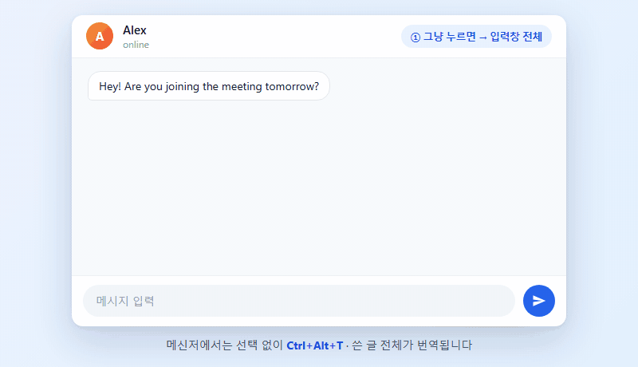
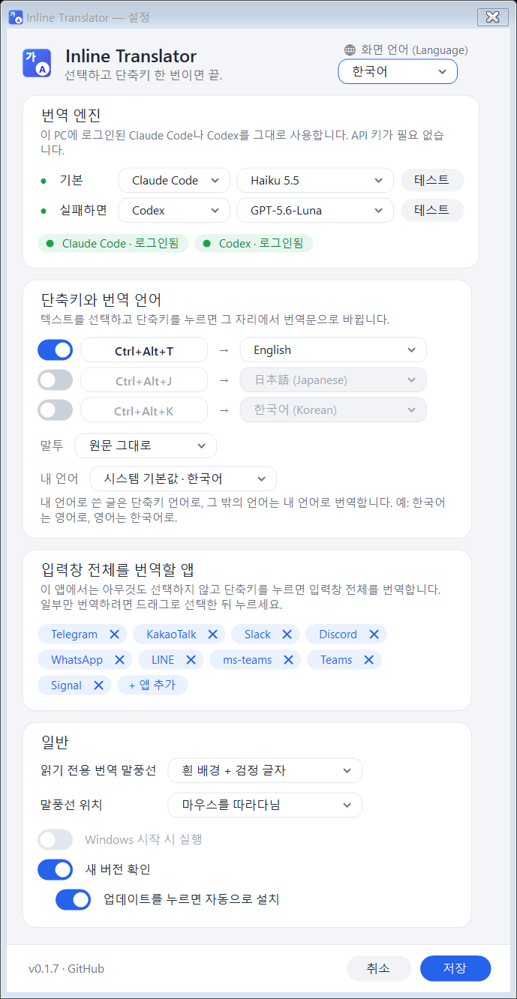

<p align="center"></p>

<h1 align="center">Inline Translator</h1>

<p align="center"><b>한국어</b> · <a href="README.en.md">English</a> · <a href="README.zh-CN.md">简体中文</a> · <a href="README.ja.md">日本語</a></p>

번역 한 줄 하려고 GPT, Claude 창 열고, 붙여 넣고, 복사해서 다시 돌아오느라 고생하셨죠?

이제 **쓰던 자리에서 단축키 한 번**이면 됩니다. 몇 초 안에 그 자리에서 번역문으로 바뀝니다.

> **원문 언어는 신경 쓰지 마세요.** 한국어든 일본어든 여러 언어가 섞여 있든, 무슨 언어인지 자동으로 알아내서 정해 둔 언어로 바꿉니다. 고를 건 "무엇으로 바꿀지" 하나뿐입니다.

<p align="center"></p>
<p align="center"><sub>실제 Claude Haiku 번역 결과로 재현한 시연 화면입니다.</sub></p>

## 이렇게 씁니다

| 이렇게 하면 | 이렇게 번역됩니다 |
|---|---|
| 💬 메신저 입력창에서 **그냥 `Ctrl+Alt+T`** | 입력창에 쓴 **글 전체**를 번역 |
| 🖱️ **드래그로 선택한 뒤 `Ctrl+Alt+T`** | **선택한 부분만** 번역 (메신저, 메일, 문서 어디서든) |

- 2~4초 뒤 그 자리에서 번역문으로 바뀝니다. 마음에 안 들면 `Ctrl+Z`.
- 선택 없이 전체를 번역하는 앱: 텔레그램, 카카오톡, 슬랙, 디스코드, 왓츠앱, 라인, Teams, Signal. 설정에서 더하거나 뺄 수 있습니다.
- 그 밖의 앱(Word, 브라우저 등)에서는 문서 전체가 바뀌는 일이 없도록 선택한 부분만 번역합니다.

## 기능

- **API 키 필요 없음** — 이미 쓰고 있는 Claude Code나 Codex 구독을 그대로 씁니다.
- **모델 선택** — Haiku 5.5, Sonnet 5.5, Opus 5.5, Fable 5, GPT 계열 등 원하는 모델로 번역합니다.
- **예비 엔진** — 기본 엔진이 실패하면 다른 엔진으로 자동으로 넘어갑니다.
- **로그인 상태 표시** — 로그인된 엔진은 초록색으로 보입니다. 로그인이 필요하면 버튼 한 번으로 로그인 창이 열리고, 번역하다 로그인이 만료돼도 알림을 누르면 바로 다시 로그인합니다.
- **앱 고르기** — 입력창 전체를 번역할 메신저는 이 PC에 설치된 앱 목록에서 골라 넣습니다. 실수로 문서 편집기를 넣어도 문서 전체가 바뀌지 않도록 막아 줍니다.
- **19개 언어** — 영어, 한국어, 일본어, 중국어(간체·번체), 스페인어, 프랑스어, 독일어, 포르투갈어, 이탈리아어, 러시아어, 베트남어, 태국어, 인도네시아어, 아랍어, 힌디어, 튀르키예어, 네덜란드어, 폴란드어. 원문 언어는 자동으로 알아냅니다.
- **단축키 3개** — 예를 들어 `Ctrl+Alt+T`는 영어, `Ctrl+Alt+J`는 일본어처럼 따로 지정합니다.
- **양방향 번역** — 내 언어로 쓴 글은 단축키 언어로, 그 밖의 언어는 내 언어로. 단축키 하나로 한국어는 영어로, 영어·일본어 등은 한국어로 바뀝니다. "내 언어"는 설정에서 바꿉니다.
- **말투 선택** — 원문 그대로, 편하게, 정중하게.
- **읽기 전용 글은 말풍선으로** — 받은 메시지, 웹페이지 본문, PDF처럼 고칠 수 없는 글을 드래그하고 단축키를 누르면, 번역을 작은 말풍선으로 보여줍니다. 아무 키나 누르거나 클릭하면 바로 사라집니다. 흰 배경·검정 글자와 검정 배경·흰 글자 중에서 고를 수 있고, 위치는 마우스를 따라다니게(기본) 하거나 선택한 글 바로 위·아래에 고정할 수 있습니다.
- **안전하게** — 번역하는 동안 다른 창으로 옮기면 붙여 넣지 않고 클립보드에만 넣어 둡니다. 원래 클립보드 내용은 되돌려 놓습니다.
- **기록 없음** — 번역한 글은 파일에도, Windows 클립보드 기록(`Win+V`)에도 남지 않습니다.
- **원클릭 업데이트** — 새 버전이 나오면 알림 영역 메뉴와 설정 창에 `업데이트` 버튼이 뜹니다. 누르면 받아서 바꾸고 다시 실행합니다.
- **화면 언어** — 한국어, English, 简体中文, 日本語. 설정 창 맨 위나 알림 영역 메뉴에서 바로 바꿉니다.

## 시작하기

1. **번역 엔진 준비** — 둘 중 하나 이상이 설치·로그인돼 있어야 합니다.
   - [Claude Code](https://docs.anthropic.com/en/docs/claude-code): 설치 후 터미널에서 `claude` 실행 → 로그인
   - [Codex CLI](https://github.com/openai/codex): 설치 후 `codex login`
2. **[최신 버전 다운로드](https://github.com/HSoo-Kim/inline-translator/releases/latest)** → `inline-translator-win-x64.zip`을 풀고 `InlineTranslator.exe` 실행.
3. 처음 실행하면 설정 창이 뜹니다. 엔진 옆 `테스트`를 눌러 번역이 되는지 확인하고 `저장`.

이후에는 알림 영역(시계 옆)에서 조용히 실행됩니다. 아이콘을 클릭하면 설정, 우클릭하면 일시 중지·종료 메뉴가 나옵니다.

Windows 11 x64용이고, 실행 파일에 .NET이 포함돼 있어 따로 설치할 것은 없습니다. 코드 서명이 없어서 처음 실행할 때 Windows가 경고를 띄울 수 있습니다.

## 설정

<p align="center"></p>

| 항목 | 내용 |
|---|---|
| 번역 엔진 | 기본 엔진과 실패 시 쓸 엔진. 모델 이름은 목록에서 고르거나 직접 입력합니다. |
| 단축키와 번역 언어 | 단축키 칸을 누르고 원하는 키 조합을 누르면 바뀝니다. |
| 입력창 전체를 번역할 앱 | 여기 적힌 앱에서는 선택 없이 단축키를 눌러도 입력창 전체를 번역합니다. 기본값: Telegram, KakaoTalk, Slack, Discord, WhatsApp, LINE, Teams, Signal |
| 화면 언어 | 앱 화면에 쓸 언어. 고르면 바로 바뀝니다. |
| 일반 | Windows 시작 시 실행, 새 버전 확인 |

## 데이터와 개인정보

- 번역할 글은 **선택한 엔진(Claude Code 또는 Codex)으로만** 보내집니다. 앱이 직접 다른 서버로 보내는 것은 없습니다.
- 엔진은 대화를 저장하지 않는 옵션으로 실행됩니다(`--no-session-persistence`, `--ephemeral`). 도구 사용은 꺼져 있고, 빈 임시 폴더에서 실행 후 바로 지웁니다.
- 오류 기록(`%LOCALAPPDATA%\InlineTranslator\error.log`)에는 오류 내용만 남고 번역한 글은 남지 않습니다.
- 새 버전 확인은 GitHub(`api.github.com`)에서 최신 릴리스 정보만 읽습니다. 업데이트 파일은 GitHub가 알려 주는 SHA-256과 맞을 때만 설치합니다. 설정에서 끌 수 있습니다.
- 설정 파일: `%LOCALAPPDATA%\InlineTranslator\settings.json`
- 번역은 쓰고 있는 구독의 사용량으로 계산됩니다.

## 알아 둘 점

- Claude Code 2.1.300, Codex CLI 0.153.2에서 확인했습니다. 너무 오래된 버전에서는 일부 옵션이 없어 실패할 수 있습니다.
- 코드 편집기 등 일부 앱은 선택 없이 `Ctrl+C`를 누르면 줄 전체를 복사합니다. 이런 앱에서는 번역할 부분을 먼저 선택하세요.
- 관리자 권한으로 실행 중인 창에는 Windows 보안 정책상 붙여 넣을 수 없습니다.
- 다른 프로그램이 같은 단축키를 쓰고 있으면 알려 드립니다. 설정에서 다른 조합을 고르세요.

## 소스 빌드

필수: Windows 11 x64, .NET 10 SDK.

```powershell
.\build.ps1                 # 빌드 + 단위 테스트
.\build.ps1 -Screenshots    # 설정 창 스크린샷을 비공개 데스크톱에서 다시 생성
.\build.ps1 -Publish        # 런타임 포함 실행 파일과 ZIP 생성
```

시연 GIF는 `docs/demo/demo.html`을 프레임별로 렌더해 만들었습니다.

```
src/InlineTranslator/   앱 (트레이, 단축키, 번역 엔진, 설정 창, 업데이트)
tests/                  설정·단축키·엔진·업데이트 회귀 테스트
tools/Preview/          설정 창 렌더링과 실제 엔진 번역 확인
tools/PrivateDesktopQa/ 사용 중인 화면을 건드리지 않는 비공개 데스크톱 실행기
```

외부 NuGet 패키지 없이 .NET Windows Forms와 Win32 API만 사용합니다.

## 라이선스

[MIT 라이선스](LICENSE). 개인·회사 모두 무료로 사용·수정·배포할 수 있으며, 배포할 때 저작권과 라이선스 고지를 함께 포함하면 됩니다.
