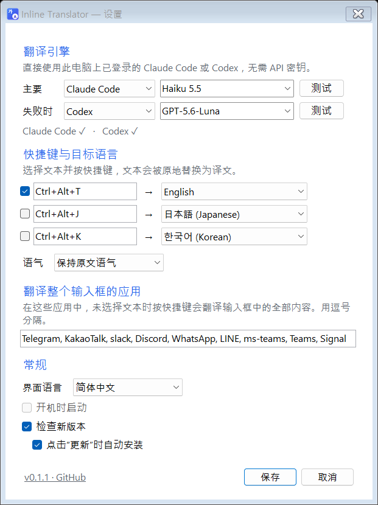

<p align="center"></p>

<h1 align="center">Inline Translator</h1>

<p align="center"><a href="README.md">한국어</a> · <a href="README.en.md">English</a> · <b>简体中文</b> · <a href="README.ja.md">日本語</a></p>

为了翻译一句话，打开 ChatGPT 或 Claude、粘贴、复制、再切回来，是不是很麻烦？

现在只需**在输入的地方按一次快捷键**，几秒内原文就会被替换为译文。

<p align="center"></p>
<p align="center"><sub>使用真实 Claude Haiku 翻译结果重现的演示。</sub></p>

## 使用方法

1. 照常输入：Telegram、Slack、邮件、文档，任何地方都可以。
2. 选中要翻译的文字，按 **`Ctrl+Alt+T`**。在聊天应用中不选中也可以，会翻译整个输入框。
3. 2～4 秒后译文替换原文。不满意就按 `Ctrl+Z`。

## 功能

- **无需 API 密钥** —— 直接使用你已有的 Claude Code 或 Codex 订阅。
- **选择模型** —— Haiku 5.5、Sonnet 5.5、Opus 5.5、Fable 5、GPT 系列，也可以直接输入模型名。
- **备用引擎** —— 主引擎失败时自动切换。
- **19 种语言** —— 英语、韩语、日语、中文（简体/繁体）、西班牙语、法语、德语、葡萄牙语、意大利语、俄语、越南语、泰语、印尼语、阿拉伯语、印地语、土耳其语、荷兰语、波兰语。自动识别原文语言。
- **3 个快捷键** —— 例如 `Ctrl+Alt+T` 译成英语，`Ctrl+Alt+J` 译成日语。
- **语气** —— 保持原文语气、随意、礼貌。
- **安全** —— 翻译期间切换了窗口，结果只放入剪贴板而不粘贴；原剪贴板内容会被恢复。
- **不留记录** —— 译文不会写入文件，也不会进入 Windows 剪贴板历史（`Win+V`）。
- **一键更新** —— 有新版本时，托盘菜单和设置中会出现“更新”按钮，点击即可下载、替换并重启。
- **界面语言** —— 한국어、English、简体中文、日本語。

## 开始使用

1. **准备翻译引擎** —— 至少安装并登录以下之一：
   - [Claude Code](https://docs.anthropic.com/en/docs/claude-code)：安装后在终端运行 `claude` 并登录
   - [Codex CLI](https://github.com/openai/codex)：安装后运行 `codex login`
2. **[下载最新版本](https://github.com/HSoo-Kim/inline-translator/releases/latest)**，解压 `inline-translator-win-x64.zip`，运行 `InlineTranslator.exe`。
3. 首次运行会打开设置。点击引擎旁的“测试”确认可用，然后“保存”。

之后它会在通知区域静默运行。单击图标打开设置，右键可暂停或退出。

适用于 Windows 11 x64，可执行文件已包含 .NET，无需额外安装。尚未进行代码签名，首次运行时 Windows 可能会提示警告。

## 设置

<p align="center"></p>

| 项目 | 说明 |
|---|---|
| 翻译引擎 | 主引擎和失败时使用的引擎。可从列表选择模型或直接输入。 |
| 快捷键与目标语言 | 点击快捷键框，按下想要的组合键。 |
| 翻译整个输入框的应用 | 在这些应用中不选中也能翻译整个输入框。默认：Telegram、KakaoTalk、Slack、Discord、WhatsApp、LINE、Teams、Signal |
| 常规 | 界面语言、开机启动、检查更新 |

## 数据与隐私

- 文本**只发送给你选择的引擎**（Claude Code 或 Codex），应用本身不会发送到其他地方。
- 引擎以不保存会话的方式运行（`--no-session-persistence`、`--ephemeral`），禁用工具，并在用后即删的空临时文件夹中运行。
- 错误日志（`%LOCALAPPDATA%\InlineTranslator\error.log`）只记录错误信息，不记录你的文本。
- 检查更新只从 GitHub（`api.github.com`）读取最新版本信息；只有 SHA-256 与 GitHub 公布的一致时才安装。可在设置中关闭。
- 设置文件：`%LOCALAPPDATA%\InlineTranslator\settings.json`
- 翻译会计入你的订阅用量。

## 注意事项

- 已在 Claude Code 2.1.300 和 Codex CLI 0.153.2 上验证。过旧的版本可能缺少部分选项。
- 部分应用（如代码编辑器）在未选中时按 `Ctrl+C` 会复制整行，请先选中文字。
- Windows 不允许向以管理员身份运行的窗口粘贴。
- 如果快捷键已被其他程序占用，会提示你在设置中更换。

## 从源码构建

需要 Windows 11 x64 和 .NET 10 SDK。

```powershell
.\build.ps1                 # 构建 + 单元测试
.\build.ps1 -Screenshots    # 在私有桌面重新生成设置截图
.\build.ps1 -Publish        # 生成自包含可执行文件和 ZIP
```

演示 GIF 由 `docs/demo/demo.html` 逐帧渲染生成。不依赖任何 NuGet 包，只使用 .NET Windows Forms 和 Win32 API。

## 许可证

[MIT](LICENSE)。个人和公司均可免费使用、修改和分发；再分发时请保留版权和许可声明。
